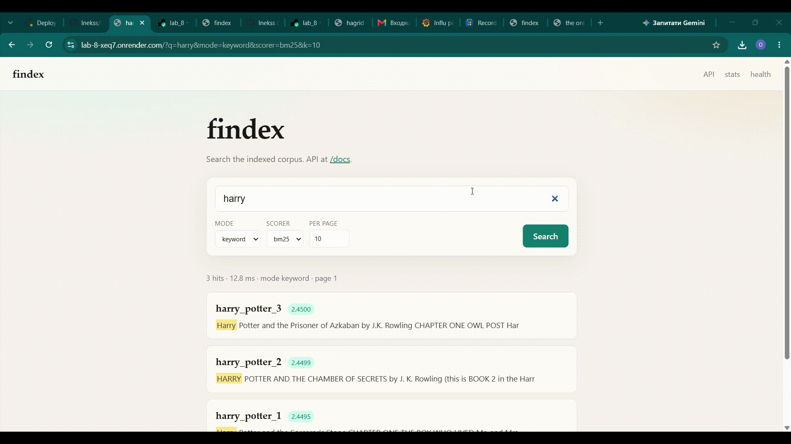
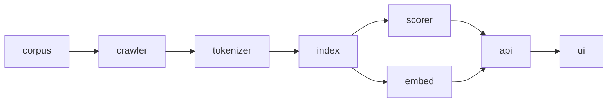

# findex

https://lab-8-xeq7.onrender.com/

Search over a saved index. Keyword (BM25/TF-IDF), semantic (embeddings), or hybrid (RRF). HTTP API + HTML page.

Corpus: 8 docs, ~70k terms, 8439 embedding chunks.  
Largest NumPy speedup measured: 9.6× (50k synthetic postings).  
p95: fill with `oha` after deploy.

Lab 08. Version 1.0.0. Tags `lab-08`, `v1.0.0`.



Demo (2–3 min): *(link)*



crawler lab 6 · tokenizer labs 1–2 · index/scorer labs 2–3/8 · embed lab 8 · api/ui lab 7–8

## Run

```bash
uv sync --group dev
uv run findex index --corpus src/resources --out-pkl index.pkl --out-json index.json
uv run findex search --index index.pkl "harry potter magic"
uv run findex serve --index index.pkl --port 8000
```

Semantic / hybrid:

```bash
uv sync --group dev --group semantic
uv run findex embed --index index.pkl --out embeddings.npy --model all-MiniLM-L6-v2
uv run findex serve --index index.pkl --embeddings embeddings.npy
```

`mode=keyword|semantic|hybrid` in CLI (`--mode`), API (`?mode=`), and the UI select.

## API

- `GET /search?q=&k=&scorer=&mode=&page=`
- `GET /docs/{doc_id}`
- `GET /stats` · `GET /health`
- OpenAPI: `/docs`

Index from `INDEX_PATH`. Embeddings from `EMBEDDINGS_PATH` (optional; Docker defaults to `/app/deploy/embeddings.npy`).

## Profile (before NumPy)

`docs/cprofile_search.txt`, `docs/cprofile_search_hotpath.txt`, `docs/search.svg`, `docs/hotspots.md`.

1. pickle load + dataclass restore of Postings — too many Python objects. Mix of C pickle and Python restore.
2. cold CLI imports — search CLI pulls crawler/rich. Python.
3. `_snippet` disk reads on the hot path — re-read txt per hit. Native I/O + Python strings.

py-spy failed on this Windows (`Failed to find python version`). Flame from cProfile + flameprof.

Postings: int32 doc_ids/tfs, one int32 doc_len. BM25/TF-IDF as array ops, top-k via `np.argpartition`. Ranking = lab 3 (`tests/test_numpy_ranking.py`). `pytest-benchmark` on search/build_index in CI.

semantic: chunks + `all-MiniLM-L6-v2`, `E @ q`, best chunk per doc. hybrid: RRF k=60.

## Tables (labs 1–8)

### Lab 1 — tokenize

| mode | docs | tokens | vocab | time (s) | peak (KiB) |
|---|---|---|---|---|---|
| light | 1 | 77600 | 6103 | 0.1642 | 1421.3 |
| heavy | 1 | 77600 | 6103 | 0.1270 | 4817.9 |

### Lab 2 — postings memory / boolean / store / positions

| representation | peak (KiB) | file (bytes) | load (s) |
|---|---|---|---|
| plain dataclass | 2379.3 | 205200 | 0.0052 |
| slots=True | 2182.4 | 168548 | 0.0090 |
| array('I') pairs | 2802.2 | 315038 | 0.0048 |

| pair | query | tf | engine | mean (s) |
|---|---|---|---|---|
| rare | `1473 1637` | 1, 1 | merge | 0.00000086 |
| rare | `1473 1637` | 1, 1 | set | 0.00000104 |
| common | `and the` | 1919, 3628 | merge | 0.00000054 |
| common | `and the` | 1919, 3628 | set | 0.00000054 |

| format | size (bytes) | save (s) | load (s) |
|---|---|---|---|
| pickle | 168528 | 0.0095 | 0.0095 |
| json | 151307 | 0.0045 | 0.0072 |

| positions | peak (KiB) | pickle (bytes) |
|---|---|---|
| off | 2182.7 | 168528 |
| on | 6428.3 | 433364 |

### Lab 3 — BM25 / precision@5 (same numbers carried in lab 4)

| term | df | weight at tf=1 |
|---|---|---|
| quirrell | 1 | 1.1673 |
| norbert | 2 | 0.4308 |

| tf | weight | step from tf−1 |
|---|---|---|
| 1 | 1.1673 | 1.1673 |
| 2 | 1.6383 | 0.4710 |
| 20 | 2.5725 | 0.0085 |
| 21 | 2.5803 | 0.0078 |

| document | tokens | b=0.75 | b=0 |
|---|---|---|---|
| harry_potter_1 | 77600 | 1.1673 | 1.0986 |
| harry_potter_3 | 104945 | 1.0182 | 1.0986 |

| query | TF-IDF | BM25 |
|---|---|---|
| quirrell | 0.20 | 0.20 |
| flamel | 0.20 | 0.20 |
| firenze | 0.20 | 0.20 |
| basilisk | 0.20 | 0.20 |
| lockhart | 0.20 | 0.20 |
| dobby | 0.20 | 0.20 |
| "chamber of secrets" | 0.20 | 0.20 |
| buckbeak | 0.20 | 0.20 |
| lupin | 0.20 | 0.20 |
| pettigrew | 0.20 | 0.20 |
| mean | 0.20 | 0.20 |

### Lab 5 — parallel index (median)

GIL on (Python 3.12):

| Executor | Workers | Wall (s) | CPU (s) | Peak RSS | Merge (s) | Speedup |
|---|---|---|---|---|---|---|
| serial | 1 | 1.029 | 0.969 | 80.9 MiB | 0.041 | 1.00× |
| threads | 1 | 1.036 | 1.000 | 84.1 MiB | 0.041 | 0.99× |
| threads | 2 | 1.077 | 1.047 | 91.5 MiB | 0.087 | 0.96× |
| threads | 4 | 1.089 | 1.062 | 91.7 MiB | 0.083 | 0.95× |
| threads | 8 | 1.070 | 1.047 | 93.8 MiB | 0.079 | 0.96× |
| threads | 12 | 1.066 | 1.062 | 96.3 MiB | 0.078 | 0.97× |
| processes | 1 | 1.773 | 1.312 | 98.8 MiB | 0.036 | 0.58× |
| processes | 2 | 1.218 | 1.375 | 96.7 MiB | 0.110 | 0.85× |
| processes | 4 | 0.998 | 1.406 | 96.0 MiB | 0.106 | 1.03× |
| processes | 8 | 0.955 | 1.594 | 95.4 MiB | 0.112 | 1.08× |
| processes | 12 | 1.017 | 1.688 | 94.3 MiB | 0.113 | 1.01× |

Free-threaded 3.13t (`sys._is_gil_enabled()` False):

| Executor | Workers | Wall (s) | CPU (s) | Peak RSS | Merge (s) | Speedup |
|---|---|---|---|---|---|---|
| serial | 1 | 1.168 | 1.109 | 108.1 MiB | 0.062 | 1.00× |
| threads | 1 | 1.153 | 1.125 | 187.2 MiB | 0.066 | 1.01× |
| threads | 2 | 0.837 | 1.156 | 217.5 MiB | 0.074 | 1.40× |
| threads | 4 | 0.706 | 1.328 | 232.7 MiB | 0.078 | 1.65× |
| threads | 8 | 0.722 | 1.453 | 239.7 MiB | 0.085 | 1.62× |
| threads | 12 | 0.707 | 1.344 | 247.2 MiB | 0.079 | 1.65× |
| processes | 1 | 2.130 | 1.562 | 164.8 MiB | 0.076 | 0.55× |
| processes | 2 | 1.377 | 1.672 | 183.5 MiB | 0.087 | 0.85× |
| processes | 4 | 1.148 | 1.859 | 171.8 MiB | 0.086 | 1.02× |
| processes | 8 | 1.147 | 2.078 | 169.6 MiB | 0.092 | 1.02× |
| processes | 12 | 1.230 | 2.203 | 172.7 MiB | 0.094 | 0.95× |

### Lab 6 — crawl (max_pages=200)

| Concurrency | Pages | Wall (s) | Pages/s | Errors | Peak RSS |
|---|---|---|---|---|---|
| 1 | 200 | 166.21 | 1.20 | 2 | 69.6 MiB |
| 5 | 200 | 79.99 | 2.50 | 2 | 73.7 MiB |
| 20 | 200 | 49.45 | 4.04 | 2 | 47.2 MiB |

### Lab 7 — handlers / oha

| | wall time |
|---|---|
| async def (blocks the loop) | 1.03 s |
| def (thread pool) | 0.09 s |

```bash
oha -z 15s -c 20 "http://127.0.0.1:8000/search?q=harry&mode=keyword"
oha -z 15s -c 20 "https://lab-8-xeq7.onrender.com/search?q=harry"
```

| Target | RPS | p50 (ms) | p95 | p99 |
|---|---|---|---|---|
| local, 1 worker, async def | | | | |
| local, 1 worker, def | | | | |
| local, 4 workers | | | | |
| deployed | | | | |

### Lab 8 — NumPy speedup

| Query | Docs matched | Lab 3 (ms) | NumPy (ms) | Speedup |
|---|---:|---:|---:|---:|
| common (`book`) | 6 | 0.010 | 0.039 | 0.3× |
| rare (`aaaaaaaaaargh`) | 1 | 0.007 | 0.073 | 0.1× |
| 3-term (`harry potter magic`) | 3 | 0.024 | 0.331 | 0.1× |
| common (50k synthetic) | 50000 | 176.312 | 18.364 | 9.6× |

Short posting lists: NumPy overhead wins. Long lists: Python Posting loop loses.

### Lab 8 — precision@5 keyword / semantic / hybrid

| query | kind | keyword | semantic | hybrid | relevant |
|---|---|---:|---:|---:|---|
| quirrell | original | 0.20 | 0.20 | 0.20 | harry_potter_1 |
| flamel | original | 0.20 | 0.20 | 0.20 | harry_potter_1 |
| firenze | original | 0.20 | 0.20 | 0.20 | harry_potter_1 |
| basilisk | original | 0.20 | 0.20 | 0.20 | harry_potter_2 |
| lockhart | original | 0.20 | 0.20 | 0.20 | harry_potter_2 |
| dobby | original | 0.20 | 0.20 | 0.20 | harry_potter_2 |
| "chamber of secrets" | original | 0.20 | 0.20 | 0.20 | harry_potter_2 |
| buckbeak | original | 0.20 | 0.20 | 0.20 | harry_potter_3 |
| lupin | original | 0.20 | 0.20 | 0.20 | harry_potter_3 |
| pettigrew | original | 0.20 | 0.20 | 0.20 | harry_potter_3 |
| turbaned teacher who shared a body with the dark lord | paraphrase | 0.00 | 0.20 | 0.20 | harry_potter_1 |
| alchemist who created a stone that grants endless life | paraphrase | 0.00 | 0.20 | 0.20 | harry_potter_1 |
| enormous serpent hidden in the school's underground pipes | paraphrase | 0.20 | 0.20 | 0.20 | harry_potter_2 |
| tiny magical servant who stole letters and warned of a plot | paraphrase | 0.20 | 0.20 | 0.20 | harry_potter_2 |
| innocent half-eagle creature sentenced to be killed by officials | paraphrase | 0.00 | 0.20 | 0.20 | harry_potter_3 |
| mean | | 0.16 | 0.20 | 0.20 | |

Three paraphrases: keyword 0.00, semantic/hybrid 0.20.

## Limits

- Brute-force `E @ q` only (fine at 8k chunks).
- Snippets still read files from disk.
- First semantic/hybrid query downloads MiniLM (~80 MB) into the container cache; needs enough RAM (torch).
- Render free tier cold start inflates p95.

## Docker

```bash
docker build -t findex .
docker run --rm -e INDEX_PATH=/app/deploy/index.pkl -p 8000:8000 findex
```

## Tests

```bash
uv run pytest --benchmark-disable
```
